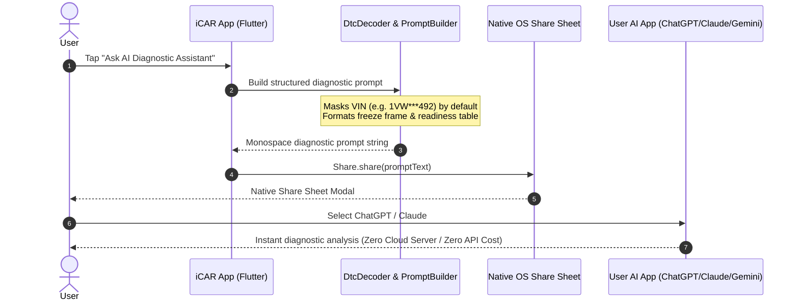

# iCAR — Technical Architecture Plan (v3.0 Flutter/Dart)

**System:** iCAR (Apple Automotive Diagnostic & Telemetry Suite)  
**Target Runtimes:** iOS 16+ & Android 10+ (API 29+)  
**Technology Stack:** Flutter 3.24+ / Dart 3.5+ / Impeller GPU Backend  
**Architecture Style:** Clean Layered Architecture (Domain Core / Infrastructure Transports / Presentation)  

---

## 1. Architectural Principles & System Boundary

iCAR is engineered for safety, extreme rendering performance in dark vehicle cabins, and resilient automotive communication over noisy serial buses.

```
┌────────────────────────────────────────────────────────────────────────┐
│                     PRESENTATION LAYER (Flutter)                       │
│    Screen Views · Frosted Glass Acrylics · Cupertino/Material Bindings │
│    Direct GPU Painting: CustomPainter on Impeller (Zero Widget Thrash) │
└───────────────────────────────────┬────────────────────────────────────┘
                                    │ ValueNotifier / Listenable Events
                                    │ (60–120 fps continuous)
┌───────────────────────────────────▼────────────────────────────────────┐
│                    APPLICATION & SERVICE LAYER                         │
│  ScanService · LiveDataService · DtcService · BatteryTestService       │
│  DiffService · AskAiHandoffService · LogService (2.0s Batched Commit)  │
└───────────────────────────────────┬────────────────────────────────────┘
                                    │ Typed Commands / Observation Streams
┌───────────────────────────────────▼────────────────────────────────────┐
│                     DOMAIN: PURE DART OBD CORE                         │
│   (Zero Flutter Imports · 100% Deterministic & Unit Tested in CLI)     │
│                                                                        │
│  ┌─────────────────────────┐         ┌──────────────────────────────┐  │
│  │ CommandQueue (Mutex)    │◄───────►│ Elm327Parser & Frame Slicer  │  │
│  └───────────┬─────────────┘         └──────────────┬───────────────┘  │
│              │                                      │                  │
│  ┌───────────▼─────────────┐         ┌──────────────▼───────────────┐  │
│  │ PollScheduler (3 Tiers) │         │ IsoTpReassembler (Multi-ECU) │  │
│  └───────────┬─────────────┘         └──────────────┬───────────────┘  │
│              │                                      │                  │
│  ┌───────────▼─────────────┐         ┌──────────────▼───────────────┐  │
│  │ PidRegistry & Formulas  │         │ DtcDecoder (SAE J2012 Engine)│  │
│  └─────────────────────────┘         └──────────────────────────────┘  │
└───────────────────────────────────┬────────────────────────────────────┘
                                    │ ASCII Chunks / Stream<List<int>>
┌───────────────────────────────────▼────────────────────────────────────┐
│                   INFRASTRUCTURE: TRANSPORTS & DB                      │
│  BleTransport (GATT Heuristics) │ WifiTcpTransport (Socket 35000)      │
│  ClassicTransport (Android SPP) │ SmartMockTransport (Desktop Sim)     │
│  Drift SQLite Storage (WAL Mode, FFI, Immutable Scan Snapshots)        │
└────────────────────────────────────────────────────────────────────────┘
```

---

## 2. Core Domain: Pure Dart OBD-II Engine

The domain layer has **zero dependencies on `package:flutter`**. It can be instantiated and executed in standalone CLI scripts, background isolates, or unit test runners.

### 2.1 Half-Duplex ELM327 CommandQueue & Framing

ELM327 microcontrollers are strictly half-duplex UART bridges. Sending any command before the adapter returns `>` corrupts the transmit buffer.

```dart
// lib/core/elm327/command_queue.dart
import 'dart:async';
import 'package:icar/core/errors/obd_error.dart';

enum CommandPriority { immediate, userAction, pollFast, pollSlow }

class QueuedCommand {
  final String id;
  final String rawCommand;
  final CommandPriority priority;
  final Duration timeout;
  final Completer<List<String>> completer;

  QueuedCommand({
    required this.id,
    required this.rawCommand,
    required this.priority,
    required this.timeout,
    required this.completer,
  });
}

class Elm327CommandQueue {
  final List<QueuedCommand> _pending = [];
  QueuedCommand? _activeCommand;
  Timer? _timeoutTimer;
  final StringBuffer _rxBuffer = StringBuffer();

  // Enqueue with priority insertion
  Future<List<String>> execute(
    String command, {
    CommandPriority priority = CommandPriority.pollFast,
    Duration timeout = const Duration(milliseconds: 2500),
  }) {
    final completer = Completer<List<String>>();
    final item = QueuedCommand(
      id: DateTime.now().microsecondsSinceEpoch.toString(),
      rawCommand: command.trim(),
      priority: priority,
      timeout: timeout,
      completer: completer,
    );

    _insertByPriority(item);
    _drainQueue();
    return completer.future;
  }

  void _insertByPriority(QueuedCommand item) {
    if (item.priority == CommandPriority.immediate) {
      _pending.insert(0, item);
      return;
    }
    final index = _pending.indexWhere((e) => e.priority.index > item.priority.index);
    if (index == -1) {
      _pending.add(item);
    } else {
      _pending.insert(index, item);
    }
  }

  void onIncomingBytes(String chunk) {
    _rxBuffer.write(chunk);
    final bufferString = _rxBuffer.toString();

    if (bufferString.contains('>')) {
      _timeoutTimer?.cancel();
      final fullResponse = bufferString.substring(0, bufferString.lastIndexOf('>'));
      _rxBuffer.clear();

      final lines = _sanitizeAndTokenize(fullResponse);
      _activeCommand?.completer.complete(lines);
      _activeCommand = null;
      _drainQueue();
    }
  }

  List<String> _sanitizeAndTokenize(String raw) {
    return raw
        .replaceAll('\r', '\n')
        .split('\n')
        .map((l) => l.trim().replaceAll(' ', ''))
        .where((l) => l.isNotEmpty && !l.startsWith('SEARCHING') && l != _activeCommand?.rawCommand)
        .toList();
  }
}
```

### 2.2 ISO-TP (ISO 15765-2) Multi-Frame Reassembly Engine

When querying Mode 09 PID 02 (VIN) or Mode 03 (Fault Codes), CAN messages exceed 7 bytes and split into multiple frames.

```
ECU (7E8) Response to Mode 09 PID 02 (VIN):
7E8 10 14 49 02 01 57 42   <-- First Frame (10 = FF, 0x14 = 20 total payload bytes)
7E8 21 41 33 47 43 32 4A   <-- Consecutive Frame 1 (Sequence 21)
7E8 22 34 46 44 31 32 33   <-- Consecutive Frame 2 (Sequence 22)
```

The `IsoTpReassembler` groups frames strictly by ECU ID (e.g., `7E8` PCM vs. `7E9` TCM) so multi-ECU simultaneous transmissions never cross-contaminate buffers.

---

## 3. Hardware Transports & Protocol Handshake

### 3.1 Transport Interface

```dart
abstract interface class Transport {
  TransportKind get kind;
  Future<void> connect(AdapterTarget target);
  Future<void> disconnect();
  Future<void> write(String asciiData);
  Stream<String> get onData;
  Stream<String?> get onClose;
  bool get isConnected;
}
```

### 3.2 Transports Implementation

1. **BLE Transport (`BleTransport`):**
   - Implemented via `flutter_reactive_ble` or platform channel.
   - Negotiates MTU size (`requestMtu(512)` on Android; iOS auto-negotiates ~185 bytes).
   - Iterates known GATT profiles (`Vgate`, `Veepeak`, `OBDLink`, `Nordic UART`) before falling back to characteristic heuristic scanning.
2. **Wi-Fi TCP Transport (`WifiTcpTransport`):**
   - Connects using Dart native `Socket.connect(ip, port)`.
   - Handles "Cellular Drop / No Internet Routing" on mobile OSes.
3. **Android Classic Bluetooth Transport (`ClassicTransport`):**
   - Uses thin native Kotlin MethodChannel wrapping `BluetoothDevice.createRfcommSocketToServiceRecord`.
   - Disabled on iOS with explanatory user dialog regarding Apple MFi limitations.
4. **Desktop Smart Mock Transport (`SmartMockTransport`):**
   - High-fidelity simulated ECU generating realistic sinusoidal RPM, speed, coolant curves, and synthetic trouble codes for desktop development and automated testing.

---

## 4. High-Performance UI Rendering Pipeline (Impeller & CustomPainter)

To achieve **60–120 fps** without CPU thermal throttling or battery drain:

```
┌────────────────────────────────────────────────────────────────────────┐
│                        LiveDataService (15 Hz)                         │
└───────────────────────────────────┬────────────────────────────────────┘
                                    │ Updates ValueNotifier<double>
                                    │ (Zero Flutter Widget Rebuilds)
┌───────────────────────────────────▼────────────────────────────────────┐
│                  RepaintBoundary + CustomPainter                       │
│  - GaugeCanvasPainter (Sweep arc, peak tick, redline danger glow)      │
│  - OscilloscopePainter (30-second double-buffered rolling waveform)    │
│  - Rendered directly by Impeller GPU pipeline                          │
└────────────────────────────────────────────────────────────────────────┘
```

- High-frequency live PIDs (RPM, Speed, Boost) update `ValueNotifier<double>` directly.
- `CustomPainter` listens to the notifier via `super(repaint: notifier)` and repaints strictly within a hardware `RepaintBoundary`.
- **Zero widget tree rebuilds** occur during live 15 Hz telemetry polling.

---

## 5. Storage Architecture & Crash Safety (Drift / WAL SQLite)

- **Database Engine:** `drift` with `sqlite3` native FFI.
- **Journal Mode:** Write-Ahead Logging (`PRAGMA journal_mode = WAL;`) enables concurrent reads and writes without blocking.
- **Batched Telemetry Logging:** Telemetry sample rows accumulate in an in-memory ring buffer and flush as a single SQLite transaction every 2.0 seconds.
- **Pre-Clear Snapshot:** Destructive DTC clear commands automatically archive an immutable snapshot prior to issuing Mode 04.

---

## 6. Local-First Privacy & Zero-Cloud AI Diagnostics



- 100% on-device SAE J2012 decoding.
- Full offline operation.
- No third-party diagnostic tracking or backend telemetry transmission.
